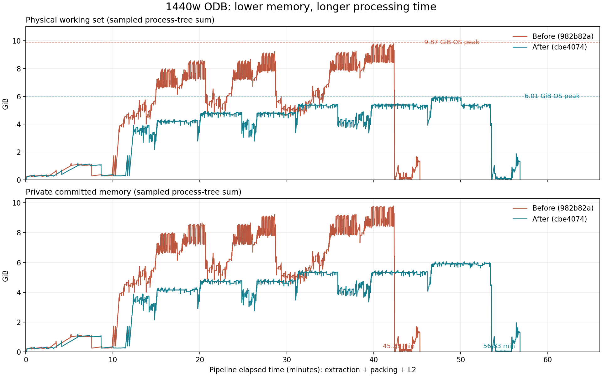

# 1440w ODB 内存优化实测

更新时间：2026年10月16日

同一份 `1440w-dof_grav_v3.odb` 已在本机分别用优化前后代码完整解析。
**内存优化有效：Windows 记录的主要解析进程物理内存峰值从 9.87 GiB 降到 6.01 GiB，减少 39.1%。
但全流程从 45分19秒增加到 56分50秒，增加 25.4%。本次结果是省内存、耗时变长，不能称为全面提速。**

两版全部 45 个 HDF5 文件、1,218 个数据集的路径、形状、类型和内容哈希一致。
本机有 32 GB 内存，未模拟只有 4 GB 可用内存的环境；不能据此保证报错电脑在相同余量下可以完成。

## 实测结果

| 指标 | 优化前 `982b82a` | 优化后 `cbe4074` | 变化 |
|---|---:|---:|---:|
| 提取＋打包＋L2 总耗时 | 2,718.738 秒（45分19秒） | 3,409.611 秒（56分50秒） | 增加 690.873 秒，约 11分31秒 / 25.4% |
| 主要进程物理工作集峰值（Windows 累计计数） | 9.873 GiB | 6.011 GiB | 减少 3.862 GiB / 39.1% |
| 主要进程提交内存峰值（Windows 累计计数） | 9.867 GiB | 6.050 GiB | 减少约 38.7% |
| 进程树物理工作集采样峰值 | 9.785 GiB | 6.022 GiB | 减少约 38.5% |
| 成功完成提取、打包、L2 | 是 | 是 | 两版均成功 |

GiB 按 1,073,741,824 字节计算。“物理工作集”是当时驻留在内存中的进程页面；
“提交内存”是系统为进程承诺提供的内存，不等于实际写入磁盘的交换文件，也不能直接当作最低机器内存配置。
上表前两项内存峰值使用 Windows 保存的单进程累计最高值，主要进程均为执行本阶段的 Python。
进程树每 0.25 秒采样一次，用作交叉核对；短暂尖峰可能漏采，共享页也可能重复计入不同进程。

| 阶段 | 优化前耗时 | 优化后耗时 | 优化前物理峰值 | 优化后物理峰值 |
|---|---:|---:|---:|---:|
| Abaqus 提取 ODB → 中间文件 | 2,543.627 秒（42分24秒） | 3,214.224 秒（53分34秒） | 9.873 GiB | 6.011 GiB |
| 中间文件 → HDF5 打包 | 115.020 秒 | 133.250 秒 | 1.043 GiB | 1.043 GiB |
| L2 几何预处理 | 60.091 秒 | 62.137 秒 | 2.008 GiB | 2.009 GiB |

三个阶段顺序运行，总内存峰值取阶段最大值，不相加。
这次最明显的降幅发生在 Abaqus 提取阶段；打包和 L2 的整体峰值基本相同。



曲线横轴为各版流水线开始后的分钟数；红线是优化前，蓝线是优化后。
上图为进程树物理工作集，下图为进程树私有提交内存；虚线为 Windows 记录的主要进程累计物理峰值。
曲线是间隔采样，因此与累计计数存在小幅差异。两条曲线按各自开始时间对齐，不是同时运行。

## 为什么变慢

业务日志中，结果提取累计时间由 32分28秒增 加到 42分04秒，约增加 9分37秒。
部分原始字段反而更快：LE 从 1分59.6秒降到 1分28.1秒，PE 从 2分14.6秒降到 1分25.5秒，
S 从 2分03.2秒降到 1分32.9秒。整段结果仍明显变慢，额外开销主要出现在字段完成后的派生结果处理及相关工作中。
这里的业务日志计时与上表包括进程启动等开销的阶段计时范围不同，不应混用。

“派生结果”是从应力、应变分量继续计算的等效应力、主应力等指标。本模型导出 28 种这样的结果。
代码对照显示：旧版每帧先重排并缓存完整张量，多种指标复用；新版为了限制内存，
每算一种指标又调用分块写入函数，重复读取数据块、查找编号、计算单元内部节点顺序，再计算指标。
这样减少了同时保留的大数组，也增加了重复工作和文件写入。

上述重复工作由代码结构可确认，但本次没有运行函数级性能分析，不能把全部增加的秒数精确归因到某一个函数。
本次只做一轮、先旧后新，操作系统文件缓存未清空，温度和其他程序负载也没有固定。
耗时是本机实测样本，若需要稳定的速度结论，应补反向次序和多次测量。

本次比较的是整套分块、磁盘映射和直接生成 `uint32` 索引的改动，未单独测量 `uint32` 一项的贡献。
不能把 39.1% 的进程内存降幅全部归给索引位宽变化。

## 输入、版本和范围

| 项目 | 本次实际设置 |
|---|---|
| 原始 ODB | `E:\code\odb-service-design\model_v2\1440w-dof_grav_v3.odb` |
| 原始文件大小 | 3,299,640,452 字节 |
| 原始 SHA-256 | `cf96c259c01760ea5b88422348dfb581dbd2100d53164fb725c6bab377e49267` |
| 模型规模 | 2,417,383 节点、2,419,250 单元；S3R/S4 壳；1 个步骤、2 帧 |
| 提取内容 | 所有步骤、帧、字段；`--invariants full`，10 个原始字段＋28 个派生字段，共 38 个结果 HDF5 文件 |
| 优化前 | `982b82aac094a18d52bfdb988baef55e2fcfb49c` |
| 优化后 | `cbe40746d6ffd786ec7164684564a2faa6a89423` |
| 优化内容 | `1cb4325` 分块/磁盘映射及失败处理；`af01ab2` 直接生成 uint32 索引 |
| 脚本 | `tools/benchmark_odb_memory.py`，工具提交 `5b16e2b` |
| 系统 | Windows 11，物理内存约 31.85 GiB；开始时可用约 18.43 GiB |
| Abaqus | 本机 Abaqus Python 3.10.5 / NumPy 1.22.4，64 位 |
| 打包和 L2 | `E:\tools\anaconda3\python.exe`；NumPy 2.3.5、h5py 3.15.1、psutil 7.0.0 |

`cbe4074` 与 `af01ab2` 的四个实际执行文件完全一致：`abaqus_dump.py`、`l1_pack.py`、
`manifest_schema.py`、`ingest.py`。后续 BDF 材料修复不参与这条 ODB 文件处理链路。
每个文件的 Git 对象号保存在原始记录中；没有切换当前主工作区，也没有改旧版实现。

先复制源文件，再用 Abaqus 升级副本；两版各使用同一升级产物的独立副本和独立输出目录。
升级用时 156.563 秒，复制和升级都没有计入上表。运行结束原始 ODB 的大小、修改时间、SHA-256
均保持一致，两份实际解析输入的哈希也保持一致。

本次覆盖后端文件处理：Abaqus 读取 ODB、写中间数据，普通 Python 打包 HDF5，再由 L2 生成表面和渲染数据。
没有启动 Web/API、模型预加载或缓存预热，不包含 HTTP 队列、模型目录导入、MySQL 和前端页面显示时间。
前端之后读取这些产物来画模型，本次没有计时浏览器加载。

## 正确性验证和证据

提取、打包、L2 三阶段均正常结束；新版收到 `ODB_DUMP_COMPLETE`，两版均产生本次全新元数据。
随后对全部 L1/L2 HDF5 文件逐个遍历数据集：路径、数组形状、数据类型和内容 SHA-256 均一致，
共 45 文件、1,218 数据集，差异为 0。数值数据按内存字节计算哈希，没有按容差放宽比较。
这项核验不覆盖 HDF5 属性、二进制文件布局和 SQLite 全表内容，不能据此声称所有文件逐字节相同。

随 Git 保存的证据：

- [阶段内存和耗时 CSV](assets/odb1440w-memory-20261016-stages.csv)
- [完整运行记录 JSON](assets/odb1440w-memory-20261016-run.json)
- [45 个 HDF5 文件的核对结果](assets/odb1440w-memory-20261016-comparison.json)
- [内存曲线 PNG](assets/odb1440w-memory-20261016.png)
- [测量工具使用方式与口径](../l1/ODB-Memory-Benchmark.md)

本机完整原始日志、0.25 秒内存采样、固定版本源码和两版输出保存在：

```text
E:\code\VirtualReal702_20260424\V2\--702\benchmark_results\20261016_odb1440w_memory_ab
```

该大目录被 Git 忽略，不随 `git pull` 分发；上面的报告、阶段 CSV、运行 JSON、核对 JSON 和图片随仓库保存。
本次按用户明确要求实际跑大 ODB，没有执行 pytest；实际解析证据与此前仅编写的回归测试应分开看待。

## 对报错电脑的判断与后续方向

原截图中申请 73.8 MiB 失败，是当时最后一次内存分配失败，不代表整个解析仅需 73.8 MiB。
这次旧版在余量充足的本机能成功，说明此前成功、此次失败可能与可用内存有关，不能只凭截图确定代码回退。
新版实测主要进程仍有约 6 GiB 的峰值，尚未证明只余约 4 GB 的电脑能稳定完成。

下一步应优先减少派生结果的重复编号查找和节点计数，同时保留分块处理和无效位置掩码，避免改变 NaN 的含义。
如果目标仍是只有约 4 GB 可用内存，需要进一步定位 Abaqus 原生数据块和帧间残留占用，
评估按字段或帧拆进程等办法，再在实际低内存环境验证。不能为减少时间而悄悄少导字段或跳过派生结果。
这些是本次测量后的改进方向，尚未实施或测量。
