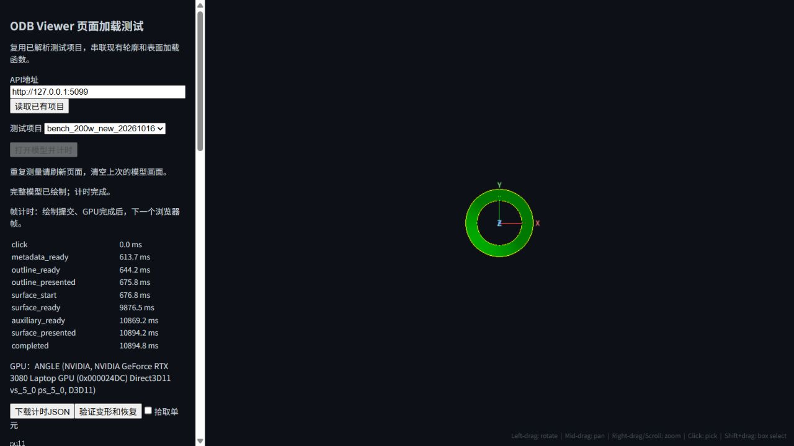

# 200w模型性能测试

实测日期：2026年10月16日。

> 后续状态：MAT1*读取问题已修复，并用同一200w模型完整生成新L1验证通过，见 [200w模型MAT1修复验证](200w模型MAT1修复验证-20261016.md)。下文保留修复前982b82a版本的性能和问题发现记录，原ready项目未被覆盖。

本轮200w圆柱模型的模型与结果导入等待由约 **762秒降至142秒**，减少约 **81.4%**；页面完整首开由 **41.81秒降至10.89秒**，减少约 **73.9%**。重复材料上色由19.11秒降至0.90秒，重复变形数据读取由9.91秒降至0.84秒。

**初轮数据正确性检查发现一项问题：被测982b82a版本快速BDF解析将本模型的材料弹性模量、泊松比从正确的 `2.1×10¹¹、0.3` 写成了 `0、0`。几何、全部10帧位移和页面变形校验通过，但该轮材料参数读取不正确。** 复现证据见下文“材料参数读取问题”。初轮只测试、定位和记录问题；后续修复及验证另见上方链接。

## 模型和对比版本

| 项目 | 实测内容 |
|---|---|
| 输入 | `E:/code/odb-service-design/model_v2/200w/200w-nodes-cylinder.bdf` 及配套OP2 |
| 文件大小 | BDF 232,075,924字节；OP2 1,497,660,508字节 |
| 模型规模 | 2,012,457个节点，2,011,200个S4R壳单元，4,022,400个渲染三角面 |
| 模态结果 | SUBCASE_1，10帧；接口基准使用frame 0，页面变形检查使用frame 9 |
| 后端历史版 | `9139bdd6ade261ff7115a07b698194f60f464e7d`，独立工作区 |
| 后端最新版 | 拉取后的 `982b82aac094a18d52bfdb988baef55e2fcfb49c`，测试前工作区无修改 |
| 解析器 | 历史版pyNastran；最新版快速BDF路径；两版均设 `APP_FAST_BDF_MIN_BYTES=1` |

“200w”沿用模型目录名；规模以实测节点数、单元数描述，不把节点数等同于自由度数。该模型只有一个材料/截面区域，不能代表多材料、多截面模型。

## 导入等待

后端先将BDF模型提取为节点、单元等中间数据，再生成可显示的表面、边线和查询索引；OP2导入提供模态位移。基础几何就绪后前端即可查看模型，高级索引仍可能在后台计算。单位：秒。

| 阶段 | 历史版 | 最新版 | 含义 |
|---|---:|---:|---|
| 基础几何可用 | 504.08 | 86.98 | 前端可开始查看模型 |
| 几何及全部高级索引就绪 | 504.08 | 126.33 | 两阶段处理全部完成 |
| 提交OP2后的总等待 | 258.15 | 54.92 | 包含排队与解析 |
| 其中OP2排队 | 16.62 | 39.35 | 新版等待高级索引完成后处理结果 |
| 其中OP2解析阶段 | 241.53 | 15.57 | 从任务领取到结果就绪 |
| 模型与结果全部就绪 | 约762.23 | 141.90 | 从提交BDF到结果可用 |

旧版先完整读取BDF约225秒，模型提取脚本约310.5秒；随后OP2转换又为坐标系检查读取BDF，OP2提取脚本总计约236.1秒。新版快速扫描约60.6秒；已有元数据确认节点均使用全局坐标系，OP2日志明确记录跳过BDF再次读取。高级索引实际处理约38.2秒。

导入为每版一次观测，状态轮询精度约1秒。旧版导入数值从首轮控制台保留到0.01秒；其762.23秒是BDF、OP2两段等待相加的近似值，不能当作毫秒精度的直接采样。导入耗时不包含正常服务启动等待，也不代表正式数字项目的模型修正数据库入库耗时。

## 常用查看操作

以下为首次请求之外两次请求的中位数，包含完整响应下载；所有请求均使用未压缩数据。单位：秒。图例和统计在对应分类上色之后测量。

| 操作 | 历史版 | 最新版 | 耗时减少 |
|---|---:|---:|---:|
| 模型几何读取 | 1.076 | 0.673 | 37.5% |
| 全部单元边线 | 7.436 | 0.425 | 94.3% |
| 按材料上色 | 19.111 | 0.901 | 95.3% |
| 按截面区域上色 | 17.456 | 0.857 | 95.1% |
| 材料图例 | 15.158 | 0.047 | 99.7% |
| 当前实例截面区域数量统计 | 39.058 | 3.849 | 90.1% |
| 整模型截面区域数量统计 | 46.598 | 3.537 | 92.4% |
| 材料区域单元边线 | 35.771 | 10.234 | 71.4% |
| 材料区域外轮廓 | 22.991 | 1.543 | 93.3% |
| 模态振型读取 | 1.204 | 0.480 | 60.2% |
| 变形坐标读取 | 9.908 | 0.843 | 91.5% |
| 动画数据读取 | 3.475 | 1.712 | 50.7% |
| 平滑云图 | 1.142 | 0.679 | 40.5% |
| 分片云图 | 4.622 | 0.733 | 84.1% |

首次操作并非全部改善：首次变形接口为 **8.71→9.92秒**，增加约1.21秒；重启API后的首次模型信息读取为 **0.405→0.666秒**。分片云图首次约 **3.14→3.11秒**，基本持平。上述首次值各只有一个样本。

新版材料分类首次仍需约12.05秒，区域单元边线重复请求仍约10.23～12.36秒，属于后续值得优化的等待。区域查询均返回4,023,657条边，外轮廓均返回2,514条边，所选内部区域标签一致；不存在拿空结果计算提速的情况。

重启API后，串行读取元信息、特征边及分块表面的完整HTTP链路首次为 **2.665→2.411秒**；重复中位数为 **2.101→1.533秒**。这包含流式SHA-256校验，不包含浏览器解析、显卡上传和绘制，不能替代下一节的页面时间。

## 页面实际显示

页面比较使用同一个新版已解析项目，隔离前端加载实现与压缩设置的影响：基线是10月15日保留的优化前生产包，交接记录对应 `496d545` 加计时观察点；新版是本次从 `982b82a` 构建的生产包。两侧后端均为982b82a，分别使用gzip 9档、1档。**这一节不是9139bdd历史前端与最新版前端的比较。**

Chrome 155，Windows，NVIDIA GeForce RTX 3080 Laptop GPU，ANGLE D3D11。浏览器1280×720，实际画布950×720，像素比例1；页面全程可见。每侧首开前重启专用API，关闭预加载、自动预热和任务runner，复用已有L1/L2；重复样本刷新页面后再打开。

| 页面阶段 | 优化前 | 最新版 | 少等 |
|---|---:|---:|---:|
| 首次轮廓出现 | 0.744 | 0.676 | 0.068 |
| 首次完整模型显示 | 41.811 | 10.894 | 30.917 |
| 刷新后完整模型显示 | 39.173 | 10.340 | 28.833 |

单位：秒。首次完整显示减少约73.9%，刷新后重复显示减少约73.6%。首开表面请求由32.44秒降至5.20秒；前端分块构建为3.39→3.77秒，未改善。基线静态打开时还花约4.04秒关联轮廓与顶点，新版将关联延迟到首次变形，因此不能认为所有操作都同步变快。

计时从页面已经打开、服务已经健康时点击“打开模型”开始，到绘制提交、GPU完成并再经过一个浏览器帧为止；不含网页脚本下载、人工停顿和首次文件导入，也不是精确显示器出光时刻。两侧截图及计数确认显示完整模型。



## 正确性核对

| 检查 | 结果 |
|---|---|
| 两版表面响应 | 字节数均为176,988,648，SHA-256完全一致，均包含4,022,400个三角面、202块 |
| 节点和单元 | 节点标签、坐标、单元标签、连接关系、面映射、节点到单元索引逐块完全一致 |
| 全部模态结果 | 10帧位移数据、节点标签、帧值、分量等逐块完全一致，位移均有限 |
| 特征边 | 原始响应排列不同；规范化端点方向和排序后，2,514条边及类型完全一致 |
| 截面分区 | 内部编号旧1、新0；该模型均只有一个分区，成员相同，分类区域标签一致 |
| 材料参数 | **未通过**：旧版E=2.1×10¹¹、ν=0.3；新版E=0、ν=0 |
| gzip传输 | 新版实际gzip响应41,399,596字节，解压后176,988,648字节，与identity响应哈希一致 |
| 输入文件 | 结束后重新计算SHA-256，与开始时相同，原始BDF/OP2未变 |

严格比较了24个HDF5数据集：22个完全一致，1个是上述截面内部编号变化，1个是材料表错误。因此原始校验JSON中的 `all_equal=false` 被保留，没有包装成全部通过。

表面响应SHA-256：`74303663570463483823aafcc3b2c271d87f63c29feaa8cb1d6e388b8fe0fb32`。

页面用benchmark_op2 / SUBCASE_1 / frame9 / scale=1验证：首次变形13.50秒、重复变形5.29秒、恢复2.82秒；这些单次时间包含坐标扫描校验，不是正式变形性能统计。两次变形均非零、无非有限坐标，5,028个轮廓端点均与所关联顶点同步；恢复后坐标及轮廓回到原值。恢复后实际鼠标拾取到S4R单元1507311，render_face_idx=3014620。

## 材料参数读取问题

初轮状态：**已定位**；现已修复并通过200w模型验证，详见 [修复验证记录](200w模型MAT1修复验证-20261016.md)。下面保留修复前的复现证据。文件中的材料行是：

```text
MAT1*    1              2.1+11          8.07692+10      .3
```

此行使用16字符宽字段，正确内容为材料号1、E=2.1×10¹¹、G=8.07692×10¹⁰、ν=0.3。`src/l1/bdf_pack.py` 的 `_bdf_fields`（本次版本第241行起）对无逗号行统一按8字符切分；扫描器在第324行对长格式GRID/PSHELL等回退，但没有覆盖MAT1。第378行的MAT1分支因此读到了空的E和ν，并用默认0写入材料表。

本轮材料分类名称仍是“1”，几何及OP2位移也一致，故相关显示耗时仍是有效测量；**材料弹性参数本身的保真检查未通过**。修复应支持MAT1长字段及需要的续行，或在不支持时回退完整解析器，并覆盖正常8字段格式。修复后应新建解析工作区验证，保持已有L1数据不可变。

机器可读的源行、错误分词、正确分词及边线核对结果见 [数据差异核对](200w数据差异核对-20261016.json)。

## 测试条件与结果范围

两版各38个接口场景、132次请求，共264次，HTTP及JSON业务状态检查均通过。每个普通场景一次首次、两次重复请求；元信息为21次。包含五种分类、图例、当前实例和整模型统计、每种分类的一个最大可见区域、几何、单元边线、模态、变形、动画及两种云图。未覆盖指定单元集elset、多材料模型或模型修正全流程；没有运行全量pytest。

初次自动流程在旧版结果就绪后发现模型修正后台又读取BDF/OP2，与接口请求争抢资源。已停止该轮专用服务，排除全部探索性接口样本；保留有效导入观测，再将两版ready数据交给只启动API、不启动runner的流程，完成上述正式264次请求。正式测量阶段日志未发现业务异常。最新版前端生产构建成功。

测试使用独立注册库和非数字测试项目号，关闭 `APP_PRELOAD_PROJECTS`、`APP_WARMUP`、`APP_EMBEDDED_RUNNER`。旧版按正常实现曾尝试模型修正导入并出现非数字项目号警告，相关时间不能外推为正式模型修正数据库入库性能。两版按历史版、最新版顺序执行，未清空操作系统或显卡缓存；本轮是同机单轮对比，首次值不能当作统计置信结论。

## 原始数据和接续入口

可随git pull取得的完整接口及导入观测CSV：[200w模型性能测试原始数据](200w模型性能测试原始数据-20261016.csv)。其中264行为正式接口请求，其余为导入观测和日志阶段时间；`elapsed_ms` 单位为毫秒，重复请求按 `temperature=repeat` 取中位数。

本机详细材料位于 `benchmark_results/20261016_200w/`，目录被Git忽略：

- `isolated/isolated_results.json`、`isolated_complete_raw_20261016_111157.csv`、`isolated_complete_report_20261016_111157.md`：完整正式测量。
- `final_results.json`：补充旧版解析器名称和导入观测来源说明的归档副本。
- `old_import_observed.json`：旧版导入控制台观测；探索轮接口数据不进入正式结果。
- `array_validation.json`、`difference_diagnosis.json`：逐块数值比较和差异定位。
- `page/`：两侧首开、重复打开、服务设置与前端文件哈希、截图、变形/拾取/传输核对记录。

保留的两版数据均位于 `tmp/benchmark_runtime/runs/20261016_101352_16948/` 下，项目号分别为 `bench_200w_old_20261016`、`bench_200w_new_20261016`；每个子目录含独立 `registry.db` 和 `data/`。后续页面复测直接复用，不重复提交导入。新版工作区仍含上述材料表错误，不能当作修复后数据。

本机配置为 `tools/benchmark_versions.20261016.200w.local.json`、`tools/benchmark_model_open.20261016.200w.local.json`；辅助脚本为 `tmp/benchmark_200w_isolated.py`、`tmp/serve_200w_page.py`、`tmp/validate_200w_arrays.py`。这些文件被Git忽略，换机需按报告条件重建；直接执行旧auto命令会重新导入，不用于现成项目的页面复测。
